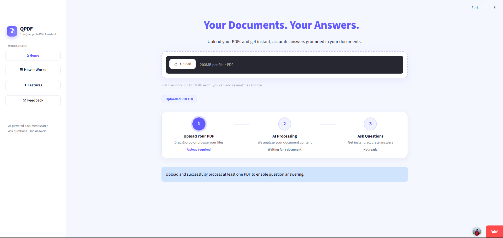
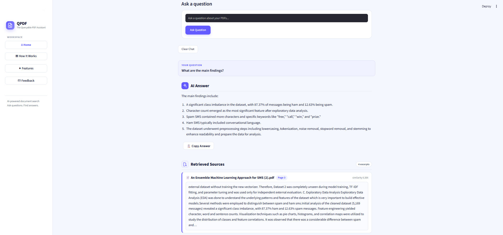

# 📄 QPDF — AI-Powered PDF Question Answering Assistant

### Chat with Your PDFs Using AI and Get Answers with Source References

QPDF is an AI-powered PDF Question Answering Assistant built using **Retrieval-Augmented Generation (RAG)**. It allows users to upload PDF documents, ask questions in natural language, and receive AI-generated answers grounded in the document content.

The application retrieves relevant passages from uploaded PDFs and uses a language model to generate answers. It also displays source excerpts, file names, and page numbers to help users verify the information.

<p align="center">
  <a href="https://ai-pdf-question-answering-assistant.streamlit.app/">
    
  </a>
  <a href="https://github.com/tanvir-50198/Ai-pdf-question-answering-assistant">
    
  </a>
</p>

---

## 🚀 Live Demo

**Try the application:**  
https://ai-pdf-question-answering-assistant.streamlit.app/

Upload a PDF, ask a question, and explore how the application retrieves relevant information and generates answers with source references.

## 📸 Application Screenshots

### 🏠 Home Page

The Home Page provides an interface for uploading PDF documents, tracking document processing, and asking questions about the uploaded content.



### 🤖 AI Answer with Sources

The application generates answers using retrieved PDF content and displays relevant source excerpts, document names, page numbers, and similarity scores.



---

## ✨ Key Features

- 📂 **PDF Upload:** Upload and process PDF documents.
- 💬 **Natural Language Questions:** Ask questions about document content using everyday language.
- 🧠 **RAG-Based Question Answering:** Retrieve relevant information before generating answers.
- 🔍 **Semantic Search:** Find relevant passages using text embeddings and FAISS.
- 📑 **Source References:** Display source file names, page numbers, similarity scores, and relevant excerpts.
- 📚 **Multiple PDF Support:** Upload and query multiple PDF documents.
- 🛡️ **Context-Grounded Responses:** Instruct the language model to answer using the retrieved document context.
- ⚡ **Model and Document Caching:** Reduce repeated processing and model-loading overhead.
- 📋 **Copy Answer:** Copy generated answers easily.
- 📝 **Feedback System:** Submit feedback, bug reports, and feature requests.
- 🎨 **Interactive Interface:** Navigate through Home, How It Works, Features, and Feedback pages.

## 🛠️ Technology Stack

| Technology | Purpose |
|---|---|
| Python | Core programming language |
| Streamlit | Interactive web application interface |
| PyMuPDF | Extract text from PDF pages |
| Sentence Transformers | Convert text into semantic embeddings |
| `all-MiniLM-L6-v2` | Text embedding model |
| FAISS | Similarity search and vector indexing |
| PyTorch | Machine learning runtime |
| Hugging Face Transformers | Load and run the language model |
| `Qwen2.5-1.5B-Instruct` | Generate answers from retrieved context |

## 🧠 How It Works

QPDF follows a Retrieval-Augmented Generation (RAG) pipeline.

1. **PDF Upload:** The user uploads a PDF document.
2. **Text Extraction:** PyMuPDF extracts text page by page.
3. **Text Chunking:** The extracted text is divided into chunks of 200 words, with a 40-word overlap.
4. **Embedding Generation:** Sentence Transformers converts each chunk into a 384-dimensional vector.
5. **Vector Indexing:** FAISS stores the vectors for similarity-based retrieval.
6. **Question Processing:** The user's question is converted into an embedding.
7. **Relevant Passage Retrieval:** FAISS retrieves up to four relevant chunks for the question.
8. **Answer Generation:** Qwen2.5-1.5B-Instruct generates a response using the retrieved context.
9. **Source Display:** The application displays the answer alongside relevant excerpts and page references.

## 🏗️ System Architecture

```text
             User
              |
              v
       Upload PDF Files
              |
              v
       Extract PDF Text
              |
              v
       Split into Chunks
       (200 words, 40 overlap)
              |
              v
     Generate Embeddings
        (MiniLM Model)
              |
              v
        FAISS Index
              |
              v
       User's Question
              |
              v
      Retrieve Relevant Chunks
              |
              v
    Qwen2.5 Instruct Model
              |
              v
       Generate Answer
              |
              v
   Answer + Source References
```

## 📂 Project Structure

```text
Ai-pdf-question-answering-assistant/
│
├── app.py                  # Streamlit user interface
├── rag.py                  # RAG engine and question answering
├── requirements.txt        # Python dependencies
├── README.md               # Project documentation
│
└── screenshots/
    ├── home.png            # Application Home Page
    └── answer.png          # AI answer with source references
```

## ⚙️ Installation and Setup

### Prerequisites

- Python 3.10–3.12 recommended
- Git
- Approximately 7 GB of free RAM recommended for CPU usage with the default model
- Approximately 3.5 GB of disk space for the initial model download

### 1. Clone the Repository

```bash
git clone https://github.com/tanvir-50198/Ai-pdf-question-answering-assistant.git
```

### 2. Navigate to the Project Directory

```bash
cd Ai-pdf-question-answering-assistant
```

### 3. Create a Virtual Environment

```bash
python -m venv .venv
```

Activate the environment on Windows:

```bash
.venv\Scripts\activate
```

For macOS or Linux:

```bash
source .venv/bin/activate
```

### 4. Install Dependencies

```bash
pip install -r requirements.txt
```

### 5. Run the Application

```bash
streamlit run app.py
```

Open the application in your browser:

http://localhost:8501

**Note:** The first run downloads the required AI models from Hugging Face. The initial download may take time and require significant disk space.

## 📖 How to Use

1. Open the [Live Demo](https://ai-pdf-question-answering-assistant.streamlit.app/).
2. Upload a text-based PDF document.
3. Wait for the document processing to finish.
4. Enter a question related to the uploaded document.
5. Click **Ask Question**.
6. Read the AI-generated answer.
7. Review the source excerpts and page numbers to verify the answer.
8. Use the Copy Answer feature if needed.

## ⚠️ Limitations

- **No OCR support:** Scanned or image-only PDFs are not supported because OCR has not been implemented.
- **Model limitations:** Answer quality depends on the document content and the language model.
- **Processing speed:** Performance depends on available CPU, RAM, GPU, and hosting resources.
- **Multiple PDF responses:** Questions involving multiple PDFs may produce separate answers for individual documents rather than one fully combined answer.
- **Answer verification:** AI-generated answers should be checked against the original documents, especially for important decisions.

## 🔮 Future Improvements

- Add OCR support for scanned PDF documents.
- Improve cross-document question answering.
- Introduce conversation memory for follow-up questions.
- Add relevance thresholds and reranking for better retrieval.
- Implement streaming responses for a smoother user experience.
- Add automated tests for text chunking, retrieval, and answer generation.
- Improve feedback storage and multi-user support.

## 🎓 Learning Outcomes

This project provided practical experience with:

- Retrieval-Augmented Generation (RAG)
- Semantic search and vector embeddings
- FAISS-based vector indexing
- PDF text extraction and preprocessing
- Integration of open-source language models
- Building interactive AI applications with Streamlit
- Context-grounded question answering and source verification

## 👨‍💻 Developer

**Abdur Rahman Tanvir**

Machine Learning & Full-Stack Development Enthusiast

- **GitHub Profile:** https://github.com/tanvir-50198
- **Project Repository:** https://github.com/tanvir-50198/Ai-pdf-question-answering-assistant
- **Live Demo:** https://ai-pdf-question-answering-assistant.streamlit.app/

---

⭐ If you find this project useful, consider giving the repository a star!

*Built with Python, Streamlit, FAISS, Sentence Transformers, PyTorch, and Hugging Face Transformers.*
